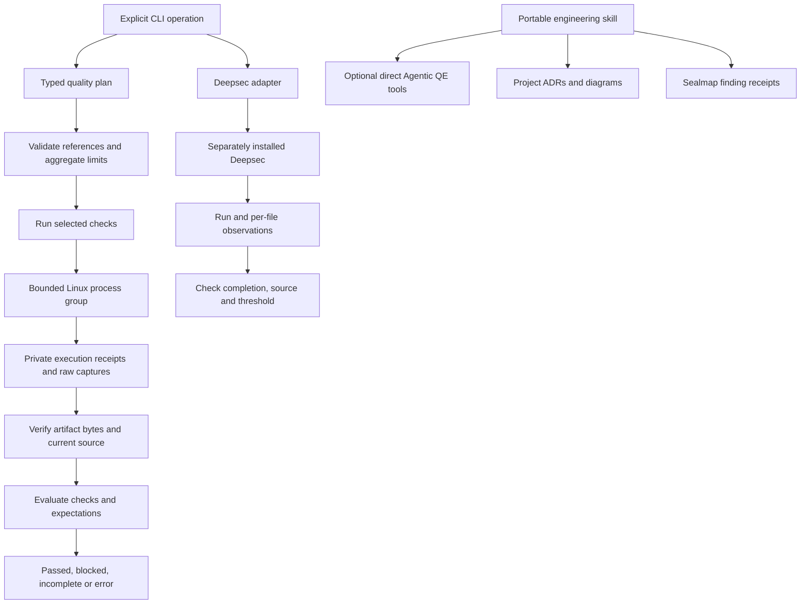

# VisionCraft diagrams and verification

The [generated overview](generated/_overview.md) and
[per-source index](generated/_index.json) are extracted by Sealmap 0.4.0. Each
source document has source hashes, symbol identities, spans and call confidence.
Generated views are read-only; edit code and regenerate rather than hand-editing
the output. CI installs the pinned Sealmap 0.4.0 release and checks this corpus
against the candidate source.

```sh
sealmap generate . --name visioncraft --public-only --min-calls 4 --no-model \
  --out docs/diagrams/generated
sealmap generate . --name visioncraft --public-only --min-calls 4 --no-model \
  --out docs/diagrams/generated --check
```

[ADR-0001](../adr/0001-portable-quality-contract.md) records the core/execution
boundary. [ADR-0002](../adr/0002-specialist-upstream-boundaries.md) records upstream
consumption. Source extraction, Mermaid rendering and runtime verification are
separate observations.

The following authored view is verified against source at
`e3306776ebab083a7842b02ce4fec4e0a2bbc77c`: `src/cli.rs:1084`,
`src/plan.rs:295`, `src/evaluate.rs:541`, `src/process.rs:594`,
`src/deepsec.rs:645` and `src/deepsec_evidence.rs:362`.



The source-derived overview currently classifies the `recorded` alias, declared
with a Rust `path` attribute in `deepsec.rs`, as an external-looking call target.
It is the local `deepsec_evidence.rs` module, not a Cargo dependency. This known
extraction limit is recorded here instead of repairing generated output by hand.
Neither inferred edges nor diagram layout establish that a runtime followed a path.
