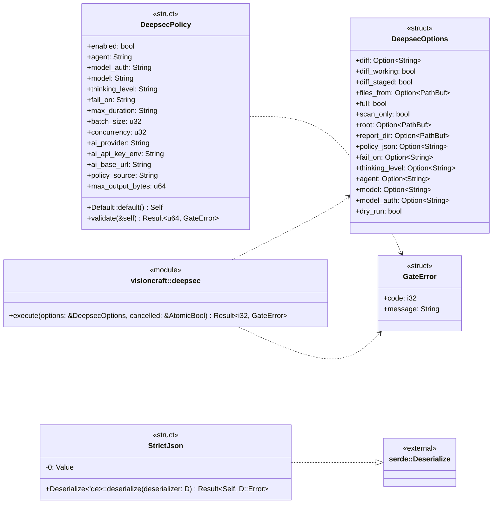
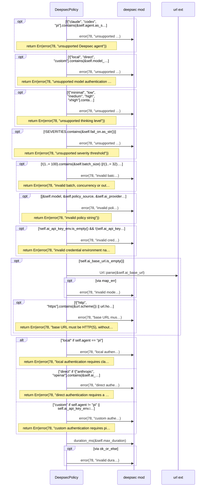
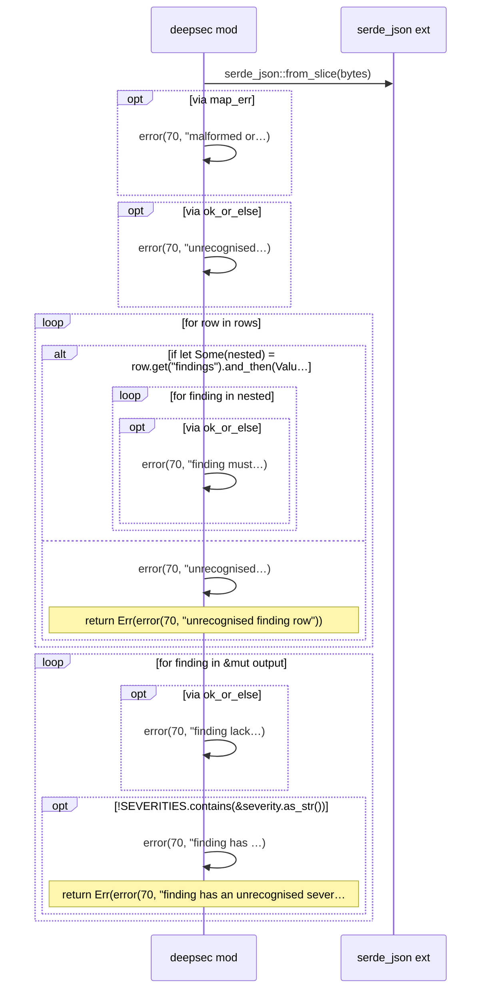
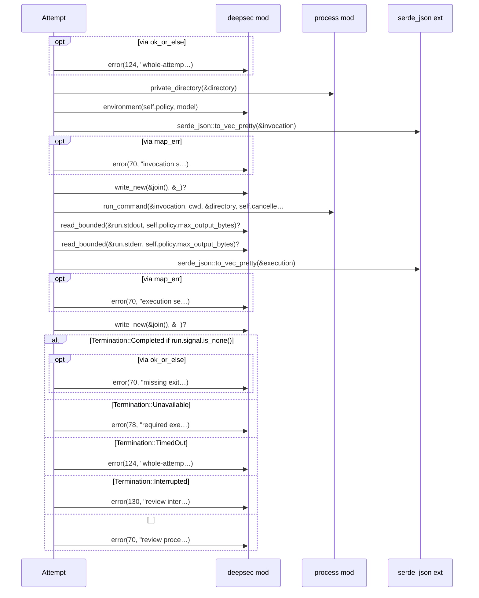

# `sym:cargo visioncraft . deepsec/` · src/deepsec.rs
> Executed Deepsec 2.3.10 gates with explicit policy and retained error states.

## structure

## `sym:cargo visioncraft . deepsec/DeepsecPolicy#validate().`
`pub fn validate(&self) -> Result<u64, GateError>` · L142-L229
> Validate policy and return the whole-attempt deadline in milliseconds.

## `sym:cargo visioncraft . deepsec/findings().`
`fn findings(bytes: &[u8]) -> Result<Vec<Value>, GateError>` · L371-L410

## `sym:cargo visioncraft . deepsec/Attempt#command().`
`fn command(&mut self, stage: &str, program: &str, args: Vec<String>, cwd: &Path, model: bool, stdin: bool,) -> Result<(i32, Vec<u8>), GateError>` · L484-L548

## `sym:cargo visioncraft . deepsec/execute().`
`pub fn execute(options: &DeepsecOptions, cancelled: &AtomicBool) -> Result<i32, GateError>` · L571-L975
> Execute an explicitly requested security gate, returning its legacy exit code.

```mermaid
sequenceDiagram
  participant visioncraft__deepsec as deepsec mod
  participant visioncraft as visioncraft mod
  participant visioncraft__deepsec___tDeepsecPolicy as DeepsecPolicy
  participant _serde_json as serde_json ext
  participant visioncraft__process as process mod
  participant _tempfile as tempfile ext
  participant visioncraft__deepsec___tAttempt as Attempt
  participant _recorded as recorded ext
  opt modes.into_iter().filter(| x | * x).count() != 1 || …
    visioncraft__deepsec->>visioncraft__deepsec: error(78, #quot;choose exact…)
    Note over visioncraft__deepsec: return Err(error(78, #quot;choose exactly one nonempty sourc…
  end
  visioncraft__deepsec->>visioncraft__deepsec: error(78, #quot;Deepsec proc…)
  alt Some(text)
    visioncraft__deepsec->>visioncraft: from_json(as_bytes())
    opt via map_err
      visioncraft__deepsec->>visioncraft__deepsec: error(78, #quot;invalid poli…)
    end
  else None
    visioncraft__deepsec->>visioncraft__deepsec___tDeepsecPolicy: DeepsecPolicy::default()
  end
  opt !policy.enabled
    visioncraft__deepsec->>visioncraft__deepsec: error(78, #quot;Deepsec gate…)
    Note over visioncraft__deepsec: return Err(error(78, #quot;Deepsec gate disabled by policy#59; …
  end
  visioncraft__deepsec->>visioncraft__deepsec: root_for(options)?
  opt Some(path)
    opt via map_err
      visioncraft__deepsec->>visioncraft__deepsec: error(78, #quot;file manifes…)
    end
    visioncraft__deepsec->>visioncraft__deepsec: read_bounded(&path, _)
    opt via map_err
      visioncraft__deepsec->>visioncraft__deepsec: error(78, #quot;file manifes…)
    end
  end
  opt options.dry_run
    visioncraft__deepsec->>_serde_json: serde_json::to_string_pretty(&plan)
    opt via map_err
      visioncraft__deepsec->>visioncraft__deepsec: error(70, #quot;plan seriali…)
    end
    Note over visioncraft__deepsec: return Ok(0)
  end
  opt !options.scan_only && policy.model_auth != #quot;local#quot; &…
    visioncraft__deepsec->>visioncraft__deepsec: error(78, #quot;configured c…)
    Note over visioncraft__deepsec: return Err(error(78, #quot;configured credential environment…
  end
  alt Ok(_)
    visioncraft__deepsec->>visioncraft__deepsec: error(78, #quot;review works…)
    Note over visioncraft__deepsec: return Err(error(78, #quot;review workspace must be an ordin…
  else Err(e) if e.kind() == std::io::ErrorKind::NotFound
    visioncraft__deepsec->>visioncraft__process: private_directory(&workspace)
  else Err(_)
    visioncraft__deepsec->>visioncraft__deepsec: error(70, #quot;review works…)
    Note over visioncraft__deepsec: return Err(error(70, #quot;review workspace unavailable#quot;))
  end
  visioncraft__deepsec->>visioncraft__deepsec: workspace_lock(&workspace)?
  opt fs::symlink_metadata(&report).is_ok()
    visioncraft__deepsec->>visioncraft__deepsec: error(78, #quot;report direc…)
    Note over visioncraft__deepsec: return Err(error(78, #quot;report directory must be new#quot;))
  end
  visioncraft__deepsec->>visioncraft__process: private_directory(&report)
  visioncraft__deepsec->>visioncraft__process: private_file(&join())
  visioncraft__deepsec->>_serde_json: serde_json::to_vec_pretty(&plan)
  opt via map_err
    visioncraft__deepsec->>visioncraft__deepsec: error(70, #quot;plan seriali…)
  end
  visioncraft__deepsec->>visioncraft__deepsec: write_new(&join(), &_)?
  opt !workspace.join(#quot;.gitignore#quot;).exists()
    visioncraft__deepsec->>visioncraft__deepsec: write_new(&join(), b#quot;*\n#quot;)?
  end
  opt fs::symlink_metadata(&config).is_ok_and(| m |!m.is_f…
    visioncraft__deepsec->>visioncraft__deepsec: error(78, #quot;configuratio…)
    Note over visioncraft__deepsec: return Err(error(78, #quot;configuration path is not an ordi…
  end
  visioncraft__deepsec->>_serde_json: serde_json::to_string_pretty(&config_value)
  opt via map_err
    visioncraft__deepsec->>visioncraft__deepsec: error(70, #quot;configuratio…)
  end
  visioncraft__deepsec->>_tempfile: NamedTempFile::new_in(&workspace)
  opt via map_err
    visioncraft__deepsec->>visioncraft__deepsec: error(70, #quot;cannot final…)
  end
  opt closure
    visioncraft__deepsec->>visioncraft__deepsec___tAttempt: command(#quot;version#quot;, #quot;deepsec#quot;, _, &workspace, false, fal…?
    visioncraft__deepsec->>visioncraft__deepsec: supported_version()
    opt rc != 0 || version_text != supported_version()
      visioncraft__deepsec->>visioncraft__deepsec: error(78, #quot;Deepsec vers…)
      Note over visioncraft__deepsec: return Err(error(78, #quot;Deepsec version does not match th…
    end
    visioncraft__deepsec->>visioncraft__deepsec___tAttempt: command(#quot;revision#quot;, #quot;git#quot;, _, &root, false, false)?
    visioncraft__deepsec->>visioncraft__deepsec___tAttempt: command(#quot;dirty#quot;, #quot;git#quot;, _, &root, false, false)?
    visioncraft__deepsec->>_recorded: recorded::select(options, as_deref(), &attempt, &root)?
    visioncraft__deepsec->>_recorded: recorded::snapshot(&root, &selected)?
    visioncraft__deepsec->>_serde_json: serde_json::to_vec_pretty(&before)
    opt via map_err
      visioncraft__deepsec->>visioncraft__deepsec: error(70, #quot;source encod…)
    end
    visioncraft__deepsec->>visioncraft__deepsec: write_new(&join(), &_)?
    visioncraft__deepsec->>visioncraft__deepsec: write_new(&source_list, as_bytes())?
    opt options.scan_only || options.full
      visioncraft__deepsec->>visioncraft__deepsec___tAttempt: command(#quot;scan#quot;, #quot;deepsec#quot;, args, &workspace, false, fal…?
      opt rc != 0
        visioncraft__deepsec->>visioncraft__deepsec: error(70, #quot;Deepsec scan…)
        Note over visioncraft__deepsec: return Err(error(70, #quot;Deepsec scan failed#quot;))
      end
      opt options.scan_only
        Note over visioncraft__deepsec: return Ok(json!({ #quot;result#quot;: #quot;SCANNED#quot;, #quot;deepsec_exit#quot;: …
      end
    end
    opt options.full
      visioncraft__deepsec->>_recorded: recorded::pending(&data, &before)?
    end
    visioncraft__deepsec->>_recorded: recorded::run_files(&data)?
    visioncraft__deepsec->>visioncraft__deepsec___tAttempt: command(#quot;process#quot;, #quot;deepsec#quot;, args, &workspace, true, f…?
    opt (options.full && rc != 0) || (!options.full && ![0, …
      visioncraft__deepsec->>visioncraft__deepsec: error(70, #quot;Deepsec proc…)
      Note over visioncraft__deepsec: return Err(error(70, #quot;Deepsec processing failed#quot;))
    end
    visioncraft__deepsec->>visioncraft__deepsec: read_bounded(&join(), policy.max_output_bytes)
    opt rc == 1 && read_bounded(&report.join(#quot;comment.md#quot;), …
      visioncraft__deepsec->>visioncraft__deepsec: error(70, #quot;exit 1 witho…)
      Note over visioncraft__deepsec: return Err(error(70, #quot;exit 1 without fresh completed fi…
    end
    visioncraft__deepsec->>_recorded: recorded::snapshot(&root, &selected)?
    visioncraft__deepsec->>_serde_json: serde_json::to_vec_pretty(&after)
    opt via map_err
      visioncraft__deepsec->>visioncraft__deepsec: error(70, #quot;source encod…)
    end
    visioncraft__deepsec->>visioncraft__deepsec: write_new(&join(), &_)?
    opt before != after
      visioncraft__deepsec->>visioncraft__deepsec: error(70, #quot;review input…)
      Note over visioncraft__deepsec: return Err(error(70, #quot;review inputs changed while the r…
    end
    visioncraft__deepsec->>_recorded: recorded::validate_review(&data, &prior_runs, &expected…?
    visioncraft__deepsec->>visioncraft__deepsec___tAttempt: command(#quot;export#quot;, #quot;deepsec#quot;, args, &workspace, false, f…?
    opt export_rc != 0
      visioncraft__deepsec->>visioncraft__deepsec: error(70, #quot;Deepsec find…)
      Note over visioncraft__deepsec: return Err(error(70, #quot;Deepsec findings export failed#quot;))
    end
    visioncraft__deepsec->>visioncraft__deepsec: read_bounded(&join(), policy.max_output_bytes)?
    visioncraft__deepsec->>visioncraft__deepsec: findings(&raw)?
    opt rc == 1 && findings.is_empty()
      visioncraft__deepsec->>visioncraft__deepsec: error(70, #quot;findings exi…)
      Note over visioncraft__deepsec: return Err(error(70, #quot;findings exit with an empty expor…
    end
  end
  visioncraft__deepsec->>_serde_json: serde_json::to_vec_pretty(&receipt)
  opt via map_err
    visioncraft__deepsec->>visioncraft__deepsec: error(70, #quot;receipt enco…)
  end
  visioncraft__deepsec->>visioncraft__deepsec: write_new(&join(), &_)?
  visioncraft__deepsec->>_serde_json: serde_json::to_string_pretty(&receipt)
  opt via map_err
    visioncraft__deepsec->>visioncraft__deepsec: error(70, #quot;receipt enco…)
  end
```

