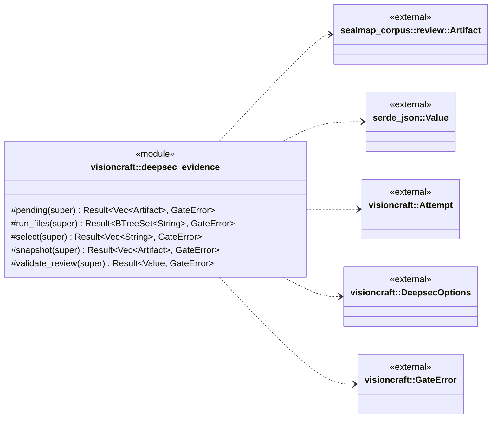
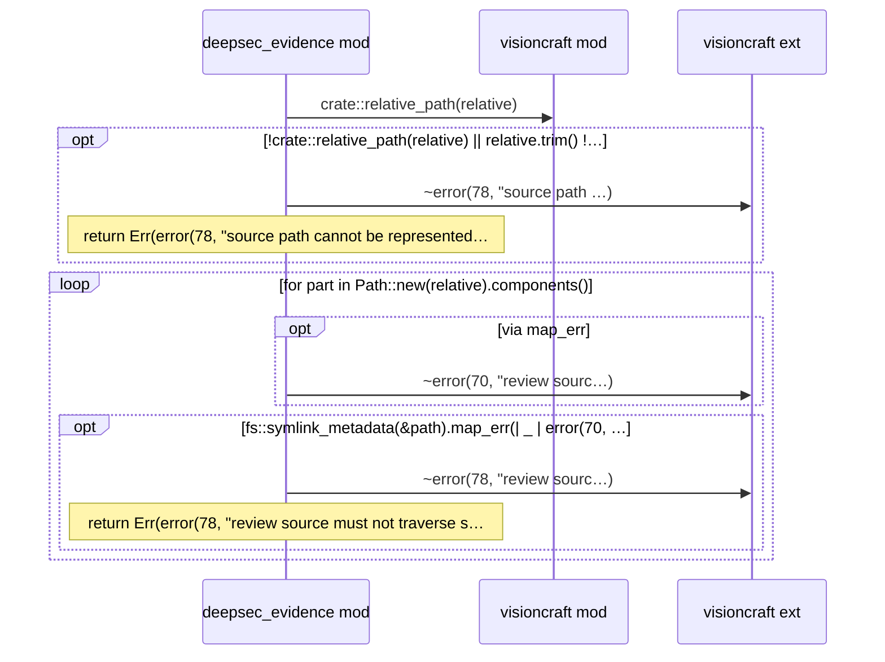
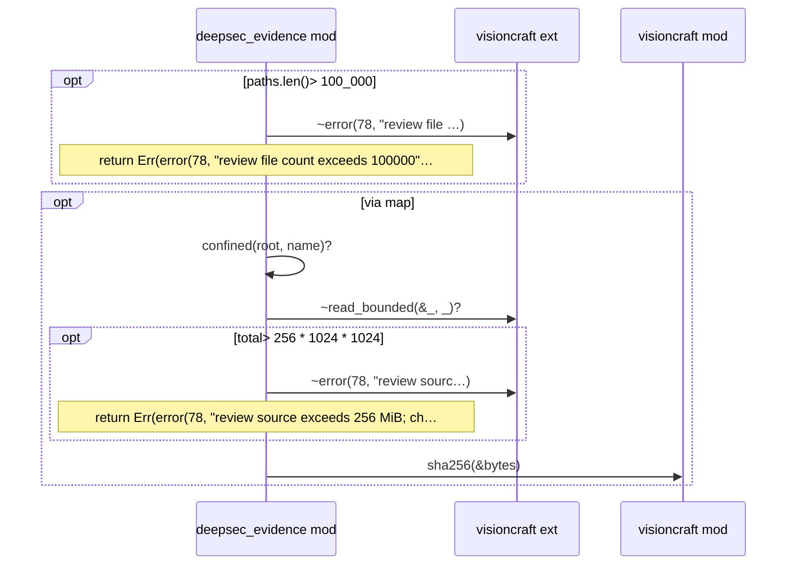
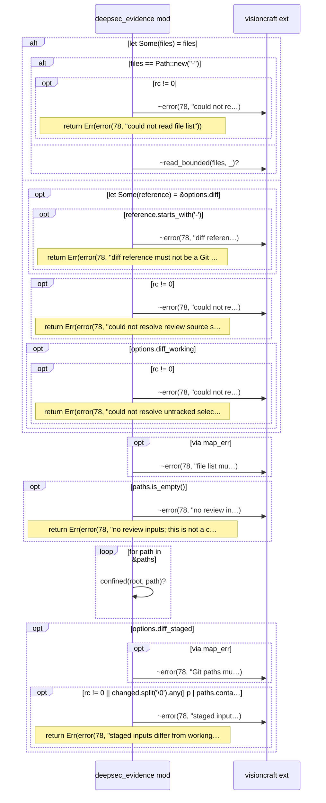
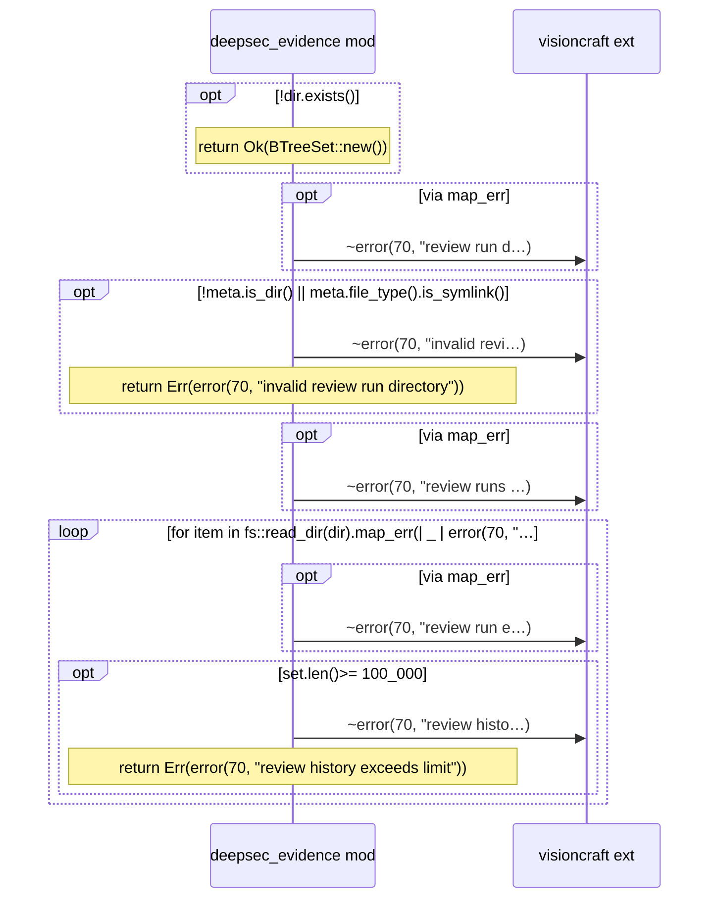
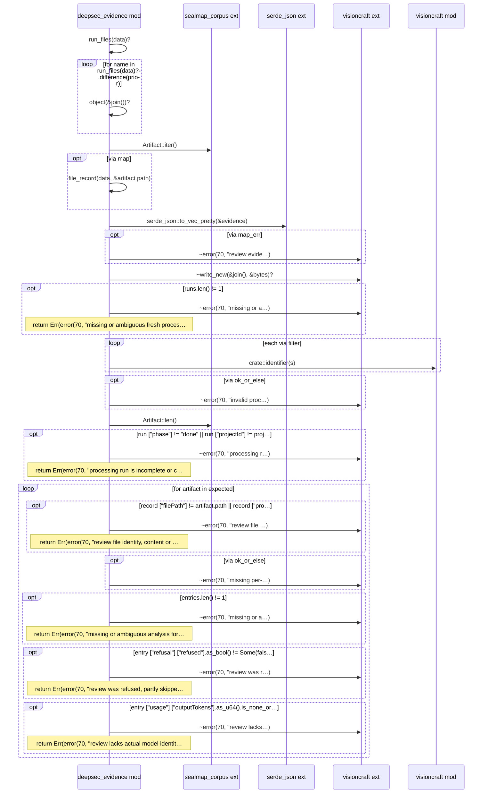

# `sym:cargo visioncraft . deepsec_evidence/` · src/deepsec_evidence.rs
> Private checks against the pinned reviewer's persisted protocol.

## structure

## `sym:cargo visioncraft . deepsec_evidence/confined().`
`fn confined(root: &Path, relative: &str) -> Result<PathBuf, GateError>` · L15-L37

## `sym:cargo visioncraft . deepsec_evidence/snapshot().`
`pub(super) fn snapshot(root: &Path, paths: &[String]) -> Result<Vec<Artifact>, GateError>` · L38-L60

## `sym:cargo visioncraft . deepsec_evidence/select().`
`pub(super) fn select(options: &DeepsecOptions, files: Option<&Path>, attempt: &mut Attempt<'_>, root: &Path,) -> Result<Vec<String>, GateError>` · L61-L169

## `sym:cargo visioncraft . deepsec_evidence/run_files().`
`pub(super) fn run_files(data: &Path) -> Result<BTreeSet<String>, GateError>` · L170-L193

## `sym:cargo visioncraft . deepsec_evidence/validate_review().`
`pub(super) fn validate_review(data: &Path, prior: &BTreeSet<String>, expected: &[Artifact], root: &Path, project: &str, report: &Path,) -> Result<Value, GateError>` · L220-L317

