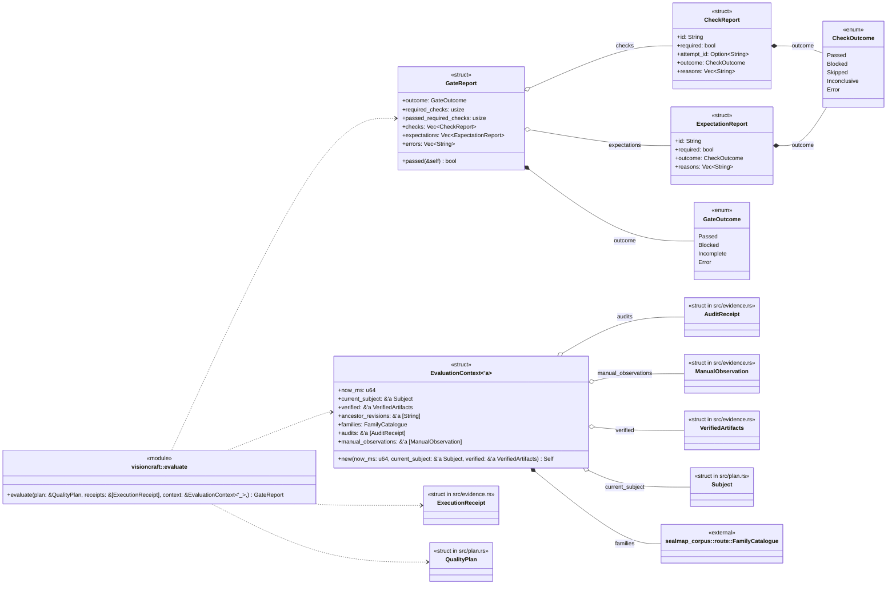
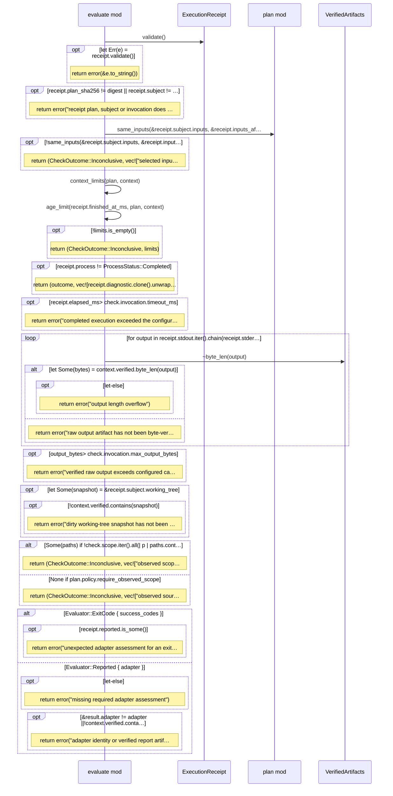
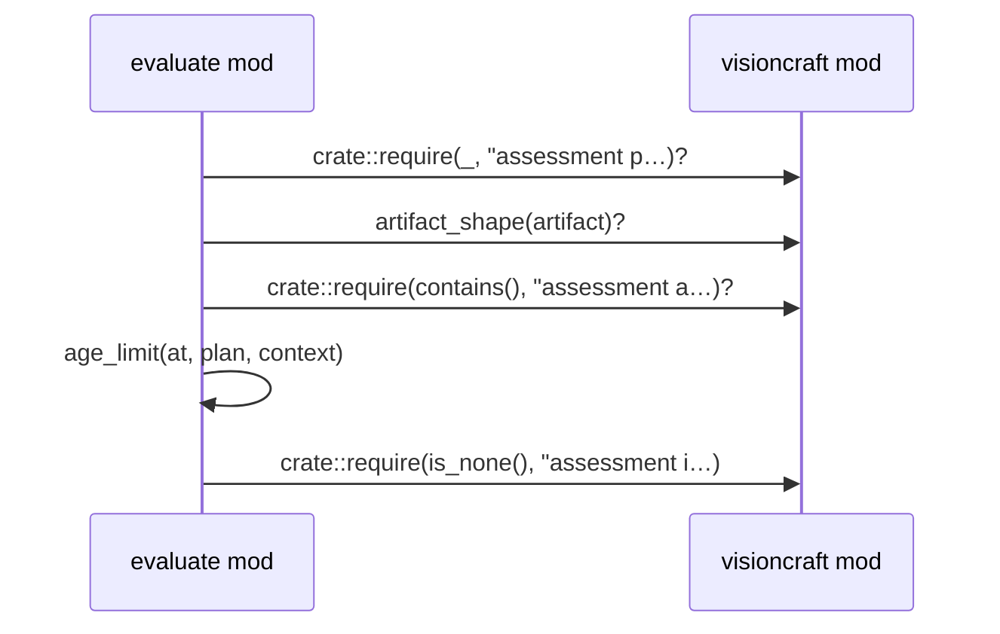
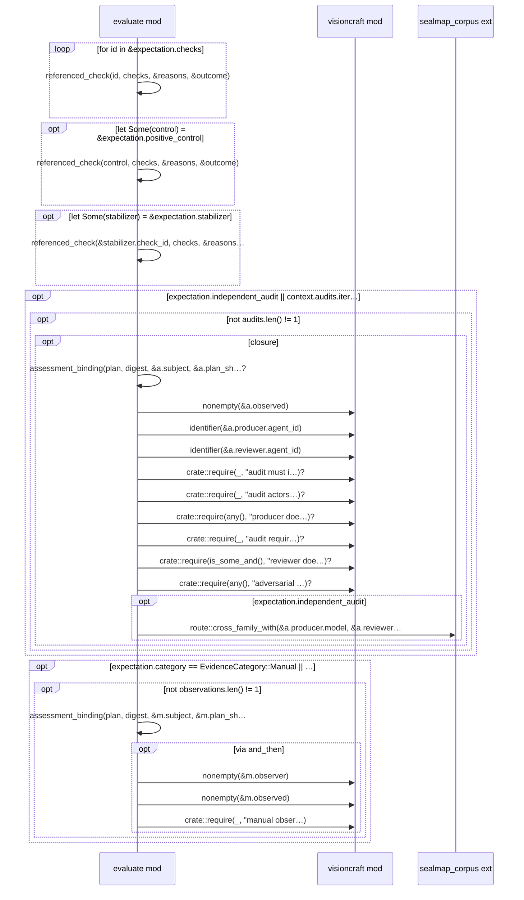

# `sym:cargo visioncraft . evaluate/` · src/evaluate.rs
> Read-only evaluation of explicit plans, exact receipts and supplied context.

## structure

## `sym:cargo visioncraft . evaluate/check_receipt().`
`fn check_receipt(plan: &QualityPlan, digest: &str, check: &crate::CheckSpec, receipt: &ExecutionReceipt, context: &EvaluationContext<'_>,) -> (CheckOutcome, Vec<String>)` · L160-L273

## `sym:cargo visioncraft . evaluate/assessment_binding().`
`fn assessment_binding(plan: &QualityPlan, digest: &str, subject: &Subject, claimed: &str, artifact: &crate::Artifact, at: u64, context: &EvaluationContext<'_>,) -> Result<(), ContractError>` · L298-L320

## `sym:cargo visioncraft . evaluate/expectation_report().`
`fn expectation_report(plan: &QualityPlan, digest: &str, expectation: &Expectation, checks: &[CheckReport], runs: &BTreeMap<&str, &ExecutionReceipt>, context: &EvaluationContext<'_>,) -> ExpectationRe…` · L322-L524

