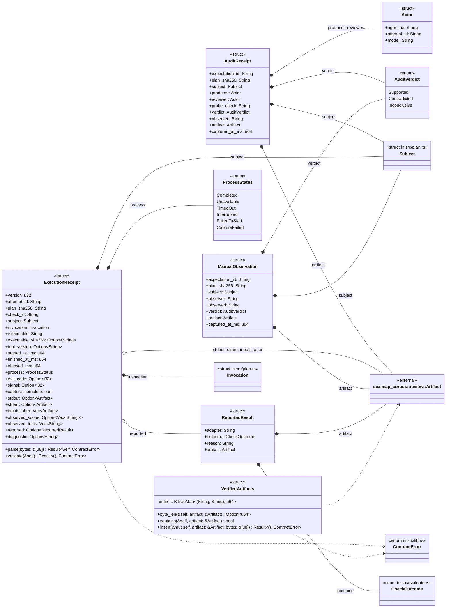
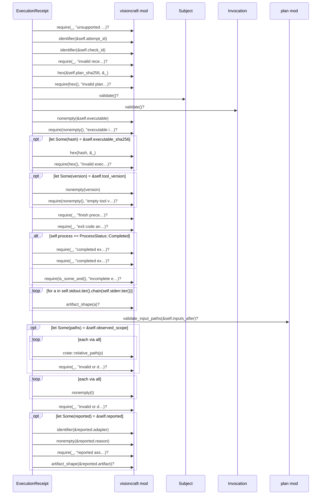

# `sym:cargo visioncraft . evidence/` · src/evidence.rs
> Immutable run and audit records, with caller-supplied byte verification.

## structure

## `sym:cargo visioncraft . evidence/ExecutionReceipt#validate().`
`pub fn validate(&self) -> Result<(), ContractError>` · L107-L178
> Check receipt consistency; matching a plan and bytes is a separate step.

