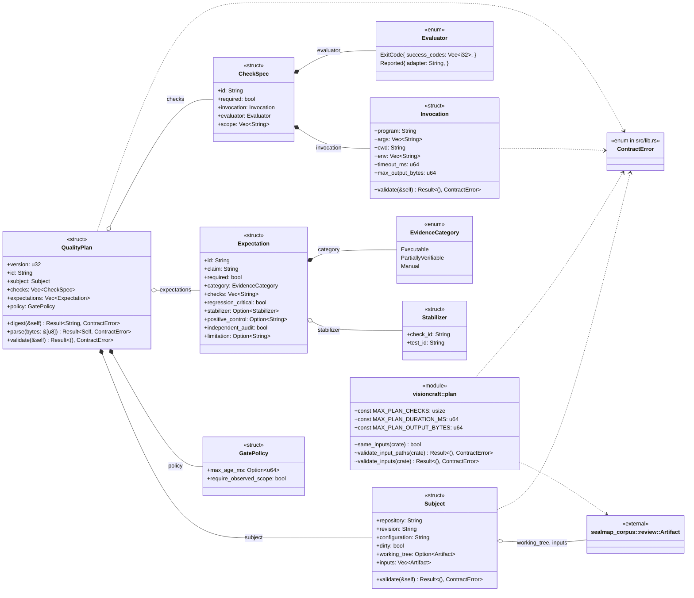
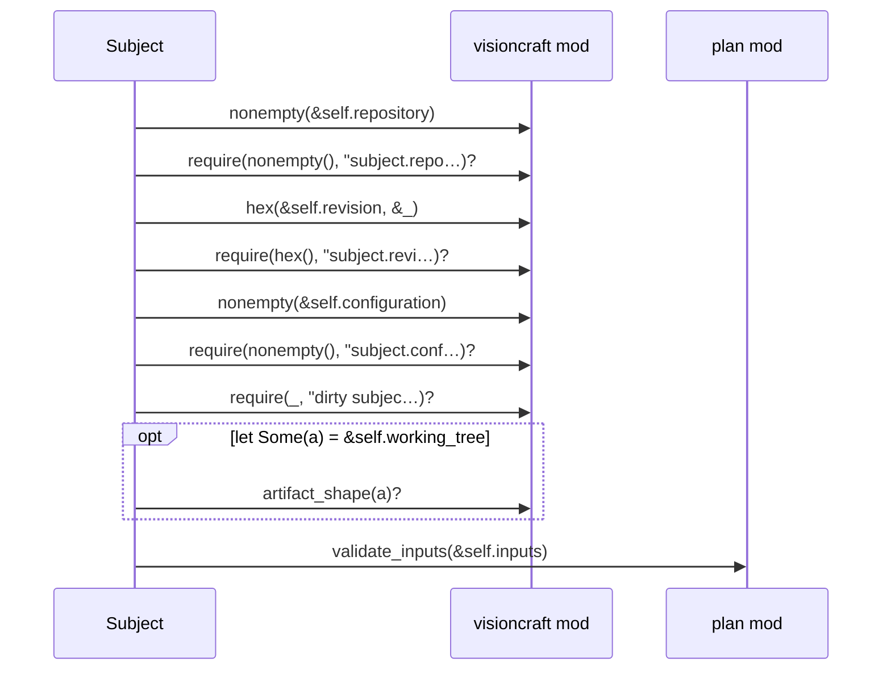
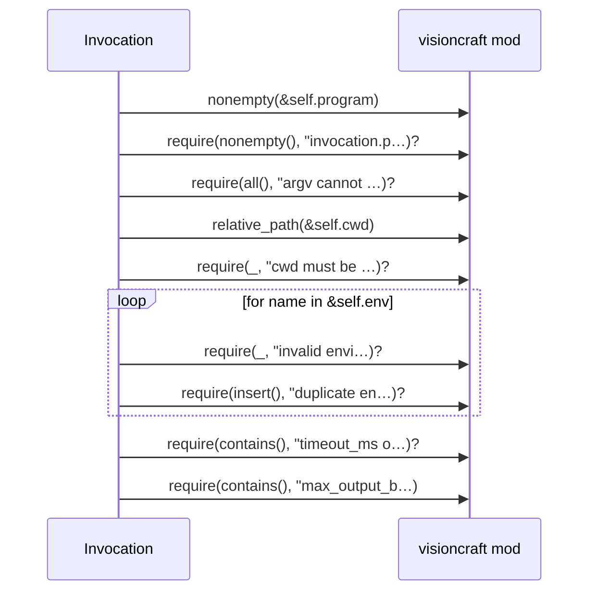
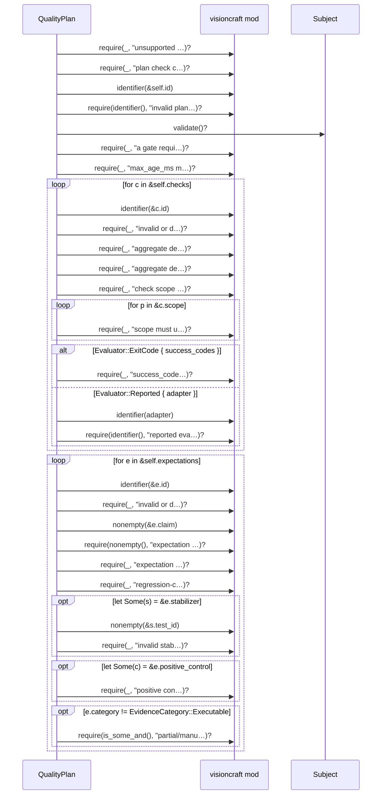

# `sym:cargo visioncraft . plan/` · src/plan.rs
> Typed plans describe explicitly selected checks; parsing never runs them.

## structure

## `sym:cargo visioncraft . plan/Subject#validate().`
`pub fn validate(&self) -> Result<(), ContractError>` · L36-L58
> Check identity, dirty-snapshot and unique input-path requirements.

## `sym:cargo visioncraft . plan/Invocation#validate().`
`pub fn validate(&self) -> Result<(), ContractError>` · L104-L137
> Validate the bounded argv contract without resolving executables or env.

## `sym:cargo visioncraft . plan/QualityPlan#validate().`
`pub fn validate(&self) -> Result<(), ContractError>` · L291-L398
> Validate identifiers, references and bounded execution policies.

