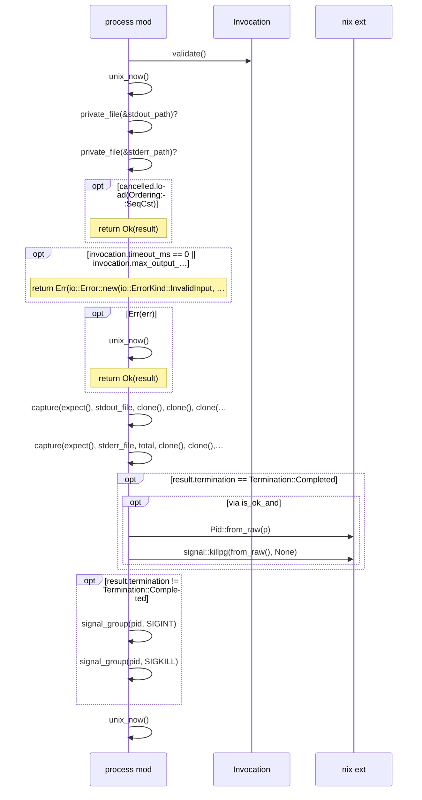

# `sym:cargo visioncraft . process/` · src/process.rs
> Bounded local command execution.

## structure

## `sym:cargo visioncraft . process/run_command_with_env().`
`pub(crate) fn run_command_with_env(invocation: &Invocation, root: &Path, output: &Path, cancelled: &AtomicBool, inherit_stdin: bool, overrides: &std::collections::BTreeMap<String, String>,) -> io::Re…` · L225-L425

