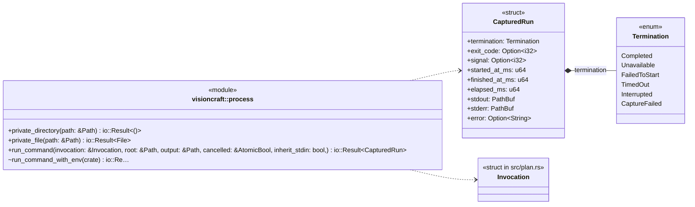
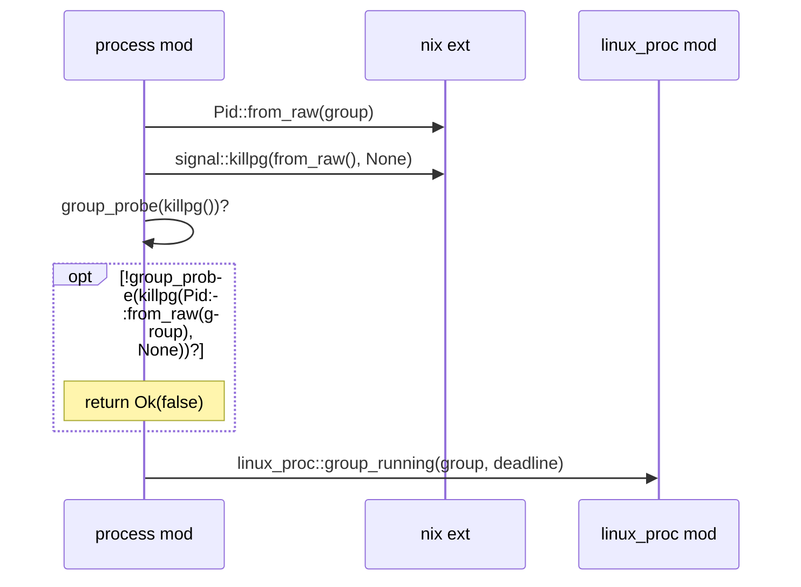
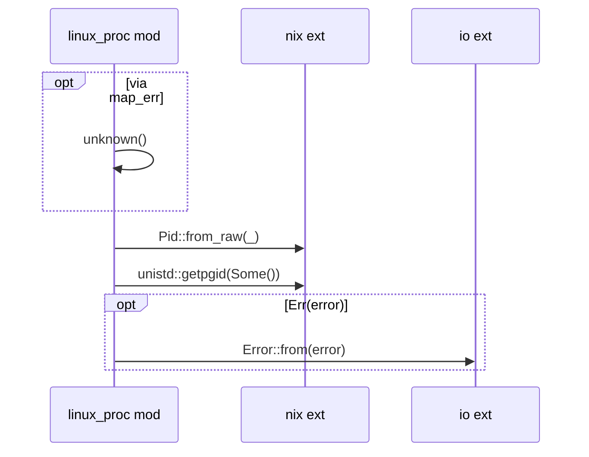
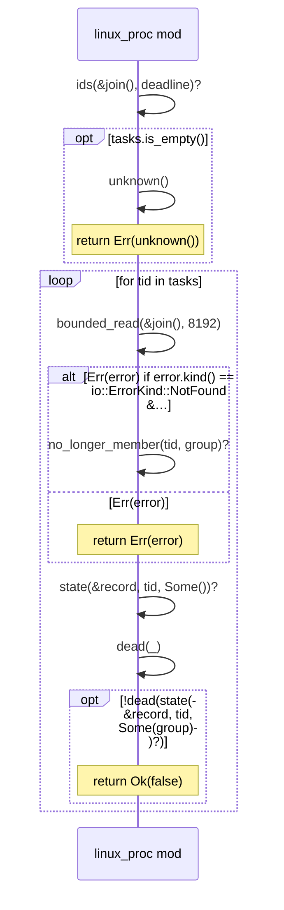
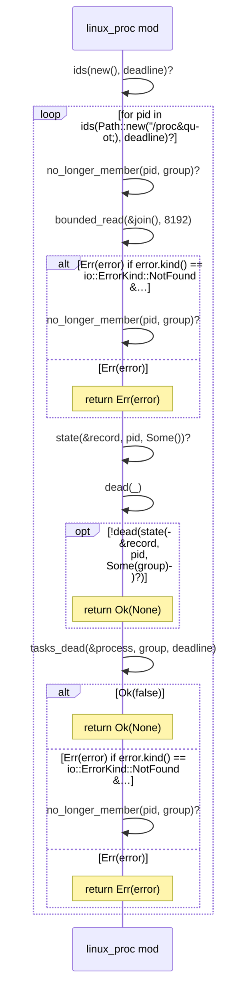
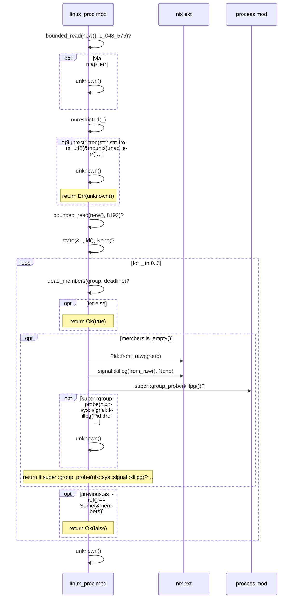
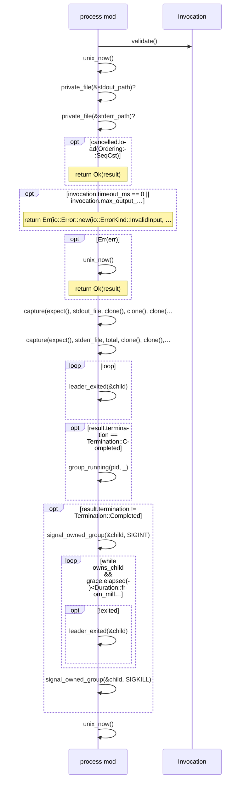

# `sym:cargo visioncraft . process/` · src/process.rs
> Bounded local command execution.

## structure

## `sym:cargo visioncraft . process/group_running().`
`fn group_running(pid: u32, deadline: Instant) -> io::Result<bool>` · L305-L318

## `sym:cargo visioncraft . process/linux_proc/no_longer_member().`
`fn no_longer_member(pid: u32, group: i32) -> io::Result<bool>` · L421-L429

## `sym:cargo visioncraft . process/linux_proc/tasks_dead().`
`fn tasks_dead(process: &Path, group: i32, deadline: Instant) -> io::Result<bool>` · L431-L451

## `sym:cargo visioncraft . process/linux_proc/dead_members().`
`fn dead_members(group: i32, deadline: Instant) -> io::Result<Option<BTreeSet<u32>>>` · L453-L487

## `sym:cargo visioncraft . process/linux_proc/group_running().`
`pub(super) fn group_running(group: i32, deadline: Instant) -> io::Result<bool>` · L489-L521

## `sym:cargo visioncraft . process/run_command_with_env().`
`pub(crate) fn run_command_with_env(invocation: &Invocation, root: &Path, output: &Path, cancelled: &AtomicBool, inherit_stdin: bool, overrides: &std::collections::BTreeMap<String, String>,) -> io::Re…` · L613-L841

